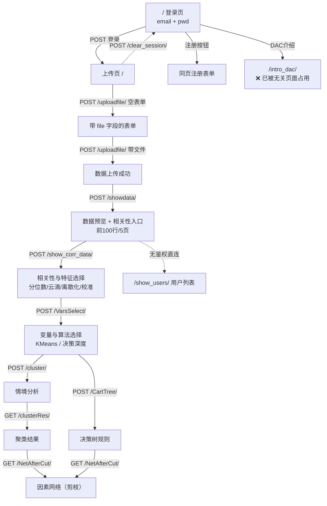
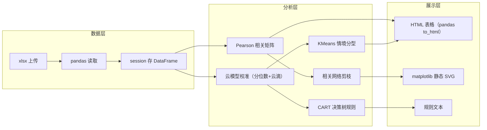

# 02 · 网站整体功能分析

## 2.1 三个地址，三套状态

| 地址 | 角色 | 技术状态 | 可用性 |
|---|---|---|---|
| `https://dac.hqu.edu.cn/` | AI4E 服务门户（2026） | 静态聚合页，8 个服务卡片 | ✅ 可访问，纯展示 |
| `https://dsim.hqu.edu.cn/dac/` | DAC 新部署实例 | 可登录；`/media/*`、`/uploadfile/` 返回 404 | ⚠️ 半成品，核心功能不可用 |
| `http://dacc.w1.luyouxia.net/` | 旧生产站（内网穿透） | 功能完整，`DEBUG=True` | ✅ 可用，但暴露面大 |

**结论（A 类证据）**：三者不是"新旧两套系统"，而是**同一套 Django 应用的三种部署状态**——
门户页只是入口聚合；`dsim` 是迁移未完成的新实例；`luyouxia` 是仍在服务的老实例。
判定依据：`/dac/` 路径在两处返回**完全相同的登录页 DOM**（标题、表单字段 `username`/`pwd`/`subt`、`/intro_dac/` 链接、页脚版权一致）。

## 2.2 门户功能清单

| # | 服务 | 入口 | 说明 |
|---|---|---|---|
| 1 | 智能考试 Smart Exam | `dsim.hqu.edu.cn/exam` | 独立子系统 |
| 2 | 智慧课程 Ai Course | `81.70.245.232/aicourse` | 独立 IP，非同域 |
| 3 | 智能导学 | `dsim.hqu.edu.cn/daoxue` | 独立 |
| 4 | 师生智能匹配 | `dsim.hqu.edu.cn/TS` | 独立 |
| 5 | **数据驱动分析 DAC** | `dsim.hqu.edu.cn/dac` | **本项目研究对象** |
| 6 | 智能就业规划 | `dsim.hqu.edu.cn/cp` | 独立 |
| 7 | 智能思政 | `dsim.hqu.edu.cn/sipe` | 独立 |
| 8 | 智能数据中台 | `dsim.hqu.edu.cn/dta` | 独立 |

> 门户本身没有统一登录（SSO），8 个服务各自独立认证——这是典型的"实验室群站"，不是产品化平台。

## 2.3 DAC 实例页面清单（A 类，逐页实测）

| # | 页面 | 路径 | 功能 | 入口 | 可用 |
|---|---|---|---|---|---|
| 1 | 登录页 | `/`（旧站）/ `/dac/`（新站） | email + 密码，无验证码 | 直接访问 | ✅ |
| 2 | 注册 | 同页按钮 | 邮箱注册 | 登录页 | ✅（B：未走完流程） |
| 3 | 上传页 | `/` 登录后 | 上传 xlsx，展示示例数据 | 登录成功 | ✅ |
| 4 | 上传接口 | `POST /uploadfile/` | 首次返回带 `file` 字段的表单，二次上传 | 上传按钮 | ✅ |
| 5 | 数据预览 | `POST /showdata/` | 前 100 行、5 页分页、列名中文化 | 上传成功 | ✅ |
| 6 | 相关性/特征选择 | `POST /show_corr_data/` | 双列表选变量、分位数、云滴、离散化、校准开关、相关矩阵、matplotlib 热力图 | 预览页"变量相关性" | ✅ |
| 7 | 变量与算法选择 | `POST /VarsSelect/` | 已校准变量、KMeans、决策深度 1~4、情境/决策分析按钮、校准后数据示例 | 上一步"下一步" | ✅ |
| 8 | 情境分析 | `POST /cluster/` | KMeans 聚类 | 上一步 | ⚠️ 复现时返回空态 |
| 9 | 情境结果 | `GET /clusterRes/` | 聚类结果表/图 | 情境分析后 | ⚠️ 返回"没有聚类结果" |
| 10 | 决策分析 | `POST /CartTree/` | CART 决策树 | 上一步 | ⚠️ 同上 |
| 11 | 网络剪枝 | `GET /NetAfterCut/` | 因素网络 | 结果页 | ❌ 直接 500（视图返回 None） |
| 12 | 用户列表 | `GET /show_users/` | 注册用户 + 使用次数 | **无鉴权直连** | ✅（安全问题，见 08） |
| 13 | 产品介绍 | `/intro_dac/` | 应介绍 DAC | 页脚链接 | ❌ 被"五年级数学速算闯关"页面占用 |
| 14 | 退出 | `POST /clear_session/` | 清会话 | 每页右上 | ✅ |
| 15 | 密码重置 | `/reset_email/`、`/password_update/` | 邮件重置 | 登录页 | B（未走完，避免打扰真实邮箱） |

## 2.4 路由关系图

## 2.5 功能结构图

## 2.6 页面技术特征（A 类）

- 全部页面为**服务端渲染 HTML**，无前端框架、无 SPA 路由、无 fetch/XHR 业务接口。
- 唯一外部 JS 是 `/media/JS/preventJS.js`（禁用右键/复制/打印，约 20 行）。
- 样式表仅 `/static/css/bootstrap.min.css` 一份。
- 图表全部由服务端 matplotlib 渲染为 **内联 SVG**（`2026-11-02T14:17:29` 这样的时间戳可作证），无交互能力。
- `<body onload="toggleFullScreen()">`：进页面强制全屏——移动端灾难。

## 2.7 门户页前端实证（REA，A 类）

用 REA 的 `inspect_web_page` 对 `https://dac.hqu.edu.cn/` 做了一次被动快照（Evidence `ev_8ef3fa787149a7bfe8b24ff5dea5b79cbe7de958d97415c9cb1d19f3061d8f01`）：

- DOM 节点 **238** 个；
- **外部脚本 0 个**，内联脚本 **1 个 / 4817 字节**（canvas 粒子动画 + 卡片光晕 + toast）；
- **网络请求 0 条**、WebSocket 0 条、localStorage/sessionStorage/IndexedDB **全空**；
- 无障碍树里只有静态文本和 8 个外链，没有任何表单或应用控件。

**推论（B 类）**：门户是手写静态页，与 DAC 应用之间只靠 `<a href>` 硬跳转，**不存在 SSO 或单点登录**。
所谓"8 个服务统一入口"实际是"8 个独立系统 + 一个好看的导航页"。

## 2.8 未解决的调查项（C 类）

1. `/cluster/`、`/CartTree/` 在自动化复现中稳定返回空状态页（变量列表为空）。判断为**依赖进程内全局状态**导致，但未能拿到成功态截图。
2. `/NetAfterCut/` 视图（`Network_after_Cutting`）直接返回 `None` → 500，图算法实现未观测到。
3. 注册流程、密码重置流程未走完（避免向真实邮箱发信）。
4. 服务器规格、并发能力、数据保留策略未知。
