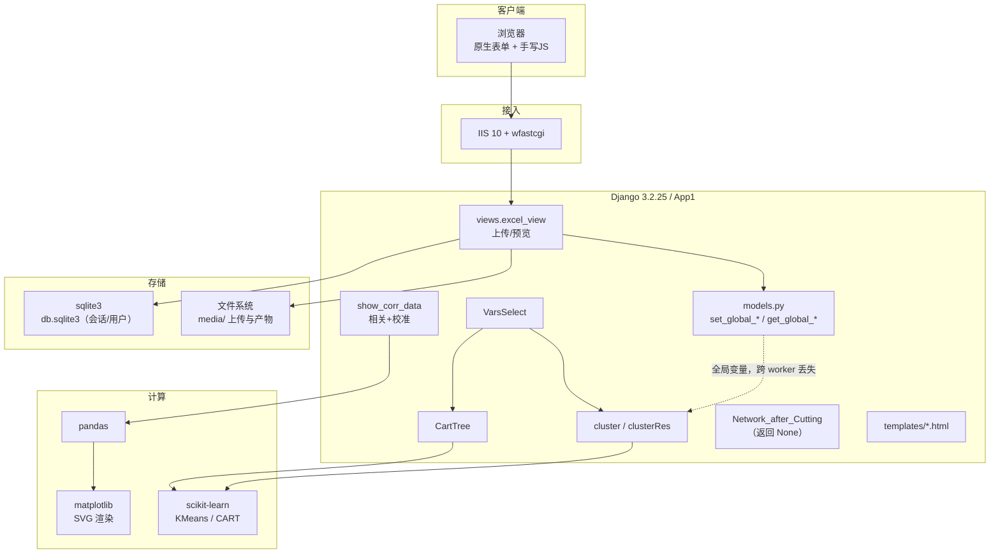
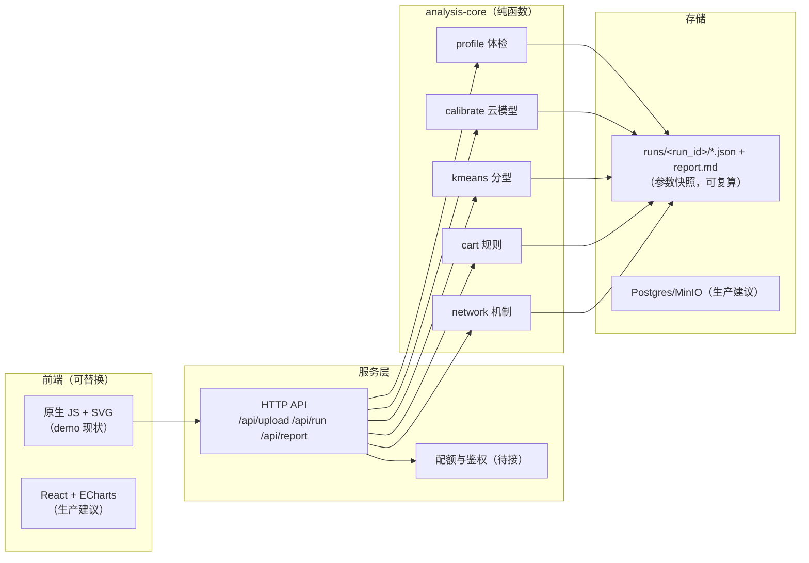

# 06 · 系统技术架构分析

## 6.1 三类信息严格分开

### A 类：已确认的技术事实

| 项 | 值 | 证据来源 |
|---|---|---|
| 后端框架 | Django 3.2.25 | 报错页 `Django Version` |
| Python | 3.8.5（Windows） | 报错页 `Python Version` / `PyExecutable` |
| 应用 | 单 app `App1`，`djangoProject1.settings` | 报错页 `Installed Applications` |
| 部署 | IIS 10 + wfastcgi（`WSGIApplication`） | 报错页 `SERVER_SOFTWARE` / `wsgi.multiprocess=True` |
| 项目路径 | `C:\inetpub\wwwroot\djangoProject1` | 报错页 `BASE_DIR` |
| 数据库 | **sqlite3**（`db.sqlite3`） | settings `DATABASES` |
| 会话 | DB 会话，`SESSION_COOKIE_AGE=3600` | settings |
| 安全开关 | `DEBUG=True`、`ALLOWED_HOSTS=['*']`、`X_FRAME_OPTIONS=DENY` | settings |
| 数据分析 | pandas + matplotlib 3.5.3 + scikit-learn（KMeans/CART） | 报错页 traceback + 页面控件 |
| 前端 | 原生 HTML + 手写 JS + `bootstrap.min.css`；**无框架、无构建** | 页面源码 |
| 图表 | matplotlib 服务端渲染 → 内联 SVG | SVG 元数据含 matplotlib 版本与生成时间 |
| 唯一外部 JS | `/media/JS/preventJS.js`（禁右键/复制/打印） | 直接下载读取 |
| 邮件 | `smtp.163.com`，账号在 settings 中（已脱敏不记录） | settings |
| 路由入口 | `djangoProject1.urls`，17 条 pattern | DEBUG 404 页全量列出 |

### B 类：有证据支持的技术推断

1. **状态保存在进程内全局变量**：源码可见 `from .models import set_global_* / get_global_*`，
   且 `cluster` / `CartTree` / `NetAfterCut` 在自动化复现中稳定丢状态。
   推断：`wsgi.multiprocess=True` 下多 worker 各自持有副本，请求落到不同 worker 即丢。
2. **数据在 session 与全局变量之间双写**：`store_dataframe_in_session(request, df, 'data1')`
   之外还有 `get_global_var()` 的痕迹（被注释掉的 `filepath = get_global_var()`）。
3. **上传文件落盘后按路径重读**：`excel_view` 里 `pd.read_excel(filepath)`，`filepath` 来自 session。
4. **图表是同步渲染**：请求内直接生成 SVG，长耗时任务会阻塞 worker（无任务队列）。
5. **KMeans 的 k 未暴露**：`/VarsSelect/` 页面无 k 输入，推断 k 固定或在下游页设定。

### 门户页的独立取证（REA Evidence `ev_8ef3fa787149a7bfe8b24ff5dea5b79cbe7de958d97415c9cb1d19f3061d8f01`）

| 观测 | 结果 | 含义 |
|---|---|---|
| 外部脚本 | 0 | 没有引入任何前端框架或库 |
| 内联脚本 | 1 个 / 4817B | 只有动画代码 |
| 网络请求 | 0 | 页面不调任何接口 |
| 存储 | localStorage/sessionStorage/IDB 全空 | 无登录态、无个性化 |
| DOM | 238 节点，全静态文本 + 8 个外链 | 纯导航页 |

> 这条证据把"新站是新一代前端"的可能性彻底排除：**门户与 DAC 应用的技术水位差着一个时代**。

### C 类：无法确认

- 服务器 CPU/内存/并发上限；
- 是否有反向代理与 WAF；
- 数据保留与删除策略；
- 是否使用 scikit-learn 的哪个版本、CART 的具体超参；
- `/NetAfterCut/` 的图算法实现（视图返回 None，未执行到算法）；
- 注册/密码重置的完整流程。

## 6.2 架构图（现状）

**关键结构性缺陷**：应用层（Django）与计算层（pandas/sklearn）在同一进程同步执行，且状态用全局变量而非数据库/任务队列 → 并发即错、长任务即超时、结果不可复现。

## 6.3 目标架构（demo 已落地左半部分）

**三条铁律**（demo 已实现前两条）：
1. 分析 = 纯函数 `analyze(data, params, seed) -> result`，无全局状态；
2. 每次运行落 `snapshot.json`（数据指纹 + 参数 + 版本 + 耗时）；
3. 配额在 API 层拦截，前端只做展示。
