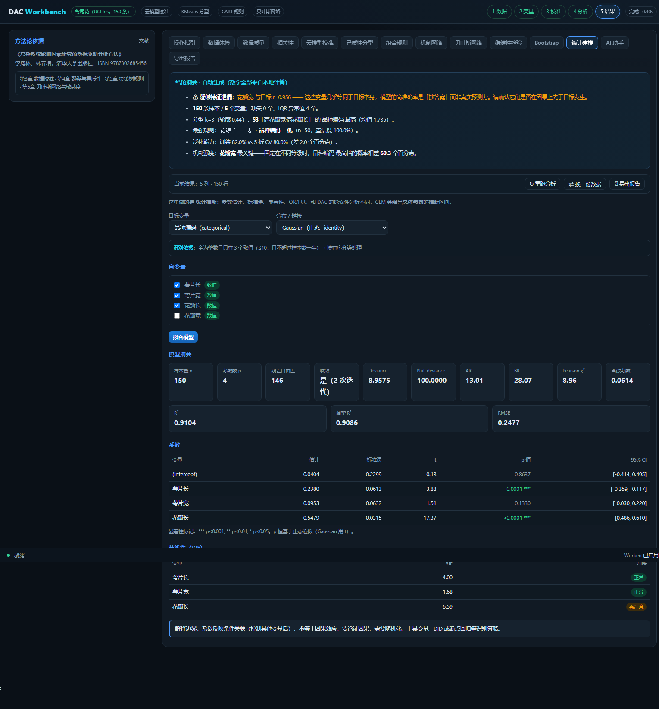

# V3.0 最终报告

## A. 版本信息

| 项 | 值 |
|---|---|
| 原始版本 | V2.9.3（main `4da4b6b`） |
| 新版本 | V3.0 |
| 分支 | `v3.0-core-correction-dev` |
| 说明 | 需求里提到的"V2.9.2 / 1192650"早于实际 main，本次基线为 `4da4b6b` |

## B. 修改清单

| 文件 | 类型 | 用途 |
|---|---|---|
| `workbench/glm.js` | 新增 | 广义线性模型（IRLS），Gaussian/Binomial/Poisson |
| `tests/test_v30.js` | 新增 | 16 项目标类型与 OOF 口径测试 |
| `tests/test_glm.js` | 新增 | 20 项 GLM 测试 |
| `tests/verify_glm_vs_statsmodels.py` | 新增 | 与 statsmodels 数值对照 |
| `workbench/core.js` | 修改 | 新增 `detectTargetType`；修 OOF 口径；离散目标不走云校准 |
| `workbench/ui.js` | 修改 | 新增「统计建模」页签；补目标/自变量校验 |
| `workbench/worker.js` | 修改 | 新增 `glmFit` 任务（UI 实际走主线程） |
| `build_workbench.py` | 修改 | 统一构建：一次生成三处产物并校验 SHA 一致 |
| `workbench/index.html` | 修改 | 新增 GLM 页签按钮 |

## C. 算法修复

### C1. 目标变量类型识别（P0）

**原问题**：二分类目标（0/1）被当连续变量做分位数云模型校准，
`lowPct=25/highPct=75` 会把 0/1 重新切成「等级」，类别定义被篡改。

**修复**：新增 `detectTargetType()`，判定 binary / categorical / count / continuous，
返回判定依据字符串供界面显示。离散目标在 `crossValidateStrict` 中**直接使用原始编码**，
`yBounds = null`，不经过 `calibrateWith`。

**验证**：`二分类目标：nLevels = 2`、`改变分位数不影响目标类别定义`、`records 里 yBounds 为 null`。

### C2. OOF 口径不一致（P0）

**原问题**：
```js
const oofY = keepIdx.map(i => yClass[i]);   // yClass 是全量 rough 校准的标签
```
而每折预测基于 `yTeCodes`（每折训练集分位数）。两者界定不同 → 合并混淆矩阵口径错误。

**修复**：新增 `oofTrue[]`，在每折记录 `yTeCodes`，OOF 汇总用各折自己的真实标签。

**验证**：`OOF 真实标签来自各折`、`OOF 准确率 = 混淆矩阵对角占比`。

## D. GLM 统计模块

| 模型 | 分布 | 链接 | 状态 |
|---|---|---|---|
| Gaussian | 正态 | identity | ✅ |
| Binomial | 二项 | logit | ✅ |
| Poisson | 泊松 | log | ✅ |
| Gamma / NB / Ordinal | — | — | 未实现 |

核心：IRLS（Fisher Scoring），高斯消元解加权正规方程，
`(X'WX)⁻¹ × dispersion` 给协方差，正态/t 近似给 p 值。

**数值验证（对照 statsmodels 0.15.0，300 行 × 3 变量含 1 个三分类哑变量）**：

| 模型 | 最大系数相对误差 | AIC/BIC | Deviance |
|---|---|---|---|
| Gaussian | **4.81e-15** | 差≈2（k 约定，见下） | 3.52e-16 |
| Binomial | **1.55e-11** | 1.62e-16 | 1.67e-16 |
| Poisson | **2.65e-14** | 1.40e-15 | 1.81e-16 |

> Gaussian 的 AIC/BIC 差异来自参数计数约定：R `glm()` 把方差算作一个参数（k=p+1），
> statsmodels `GLM` 不计数（k=p）。差值恰为 2（AIC）与 log(n)（BIC），已核实。

**异常处理**（全部有测试）：
完全分离（检出并置 error 级警告）、过度离散（Pearson χ²/df>1.5 报警）、
完全共线（抛错）、常数变量（VIF=∞）、小样本（n<10p 警告）、
目标类型不符（Poisson 拒绝负值/非整数；Binomial 拒绝非 0/1）、样本量不足（抛错）。

## E. 智谱 GLM API 实测

**说明**：无法读取用户浏览器中的已有配置（跨域隔离），
因此使用用户本轮提供的 Key 在服务端直连测试，**未写入任何文件**。

| 项 | 结果 |
|---|---|
| 模型列表 `GET /models` | ✅ 12 个：glm-4.5 / 4.5-air / 4.6 / 4.7 / 5 / 5-turbo / 5.1 / 5.2 / 5.3 / 5.3-flash / 5.3-flashx / 5.3-flashx-legal |
| 对话（glm-4-flash） | ✅ 1359 ms，返回「连接成功」，用量 in=11 out=4 |
| Base URL | `https://open.bigmodel.cn/api/paas/v4`（与代码预设一致） |
| API Key | 未输出、未落盘 |

**未能验证**：应用内配置读取、刷新持久化、连续对话 —— 这些需要用户在浏览器里操作。

## F. Bootstrap

V2.9 引擎保留未动，四套测试（31 项）继续通过。
本轮**未实现** OOB、Block Bootstrap、大样本稀疏化（见 J 节）。

## G. 前端

新增「统计建模」页签，包含：模型选择、目标类型自动识别与依据展示、
自变量勾选（自动区分数值/分类）、参考类别选择、系数表（含 OR/IRR 与 CI）、
OR/IRR 森林图（对数刻度）、ROC 曲线、混淆矩阵、VIF 表、诊断警告。



## H. 测试

| 套件 | 数量 | 结果 |
|---|---|---|
| test_core.js | 33 | ✅ |
| test_v21.js | 32 | ✅ |
| test_bootstrap.js | 31 | ✅ |
| test_glm.js | 20 | ✅ |
| test_v30.js | 16 | ✅ |
| **合计** | **132** | **100%** |
| statsmodels 对照 | 3 模型 | ✅ 系数一致到 1e-11 |

## I. 部署

- 构建：`python build_workbench.py` → 一次生成 `DAC-Workbench.html` / `docs/index.html` / `public/index.html`
- 三份产物 SHA1 必须相同，否则构建失败（防止"改了源码但线上没更新"）
- 部署地址：https://11sj817.github.io/dac-workbench/

## J. 未解决问题

| 项 | 状态 |
|---|---|
| OOB 表现 | ❌ 未实现 |
| Block Bootstrap | ❌ 未实现 |
| Bootstrap 大样本稀疏共聚类 | ❌ 未实现 |
| GLM 的 Gamma / 负二项 / Ordinal | ❌ 未实现 |
| GLM 走 Worker | ⚠️ 已实现 `glmFit` 任务但 UI 改走主线程（传输整表得不偿失） |
| 左侧固定主导航重构 | ❌ 本轮未做，保留原标签页结构 |
| 加权 GLM（频率权重/抽样权重） | ❌ 未实现 |
| 跨浏览器（Firefox/Safari） | ❌ 仅测 Chrome 156 |
| 智谱 API 的应用内完整验证 | ⚠️ 需用户在浏览器操作 |

## K. 本轮修掉的 4 个开发期缺陷

1. `detectTargetType` 小样本阈值退化（`floor(n*0.05)` 在 n=12 时为 0）→ 改为「取值数≤10 且≤样本数一半」
2. GLM UI 系数表 `forEach` 块漏写 `});` → 语法错误
3. `family` 初始为空串 → 「不支持的分布：」
4. UI 未校验目标变量是否存在与是否为数值 → 目标名写错时静默产生全 NaN 系数

第 4 条尤其危险：**如果不加 NaN 守卫，界面会把一堆 NaN 当成正常结果显示**。
现在 IRLS 每次迭代都检查有限性，目标与自变量也做前置校验。


---

# 附录：V3.1 自检与修复

## 自检结果（全部实测）

| 检查项 | 结果 |
|---|---|
| 密钥扫描（全仓库含未跟踪文件） | ✅ 无 `sk-*`、无 GLM key 片段、无 GitHub token |
| git 全历史扫描 | ✅ 无 `sk-REDACTED`、无 `REDACTED` |
| 本机绝对路径 | ✅ 0 处 |
| 线上 HTML | ✅ 无密钥、无本机路径 |
| 五套测试 | ✅ 132 / 132 |
| 构建三处一致性 | ✅ SHA1 相同 |
| 代码 TODO/FIXME | ✅ 无 |
| 本地临时文件 | ✅ 清理 989 MB（`.chrome-*` / `_scaffold` / `_v*.py`） |

## 本轮修掉的 3 个真实缺陷

### 1. GLM 不做缺失值处理（功能性）

**原行为**：自变量有缺失 → 直接抛「不是有效数值」。
**修复**：拟合前用 `fitImputer`（中位数 / 分类列众数）补齐，并**在结果页显示填补了多少单元格、多少行、用什么策略**。

实测（Auto-MPG，含 3 个真实缺失）：
```
缺失值已填补：涉及 3 个单元格 / 3 行，策略 = 中位数（分类列用众数）
样本量 300 · 参数 7 · 残差自由度 293 · 收敛（2 次迭代）
```
同时给出警告：「填补会低估标准误，缺失较多时结论宜保守」。

### 2. renderTab 守卫把独立功能也挡住了（可用性）

**原代码**：
```js
if (!S.res && S.tab !== 'guide') { pane.innerHTML = '先导入数据并运行分析。'; return; }
```
换数据后 `S.res` 被清空 → **统计建模 / 数据质量 / Bootstrap 全部无法打开**。

**修复**：改为白名单，只有真正依赖 DAC 结果的页签（corr/calib/scene/rules/net/bn/robust/ai/report）才要求 `S.res`。

### 3. GLM 目标/自变量缺少前置校验（正确性）

**原行为**：目标列名写错时，`y` 全是 `undefined` → 系数全是 NaN，**界面把它当正常结果显示**。

**修复**：
- 目标必须在当前数据里，且全为有限数值
- 自变量同样校验
- IRLS **每次迭代**检查系数有限性，非有限直接抛错并指出是哪些变量

## 仍未解决

| 项 | 状态 |
|---|---|
| OOB 表现 | ❌ |
| Block Bootstrap | ❌ |
| 前端左侧导航重构 | ❌ |
| 加权 GLM | ❌ |
| 跨浏览器测试 | ❌ 仅 Chrome 156 |
